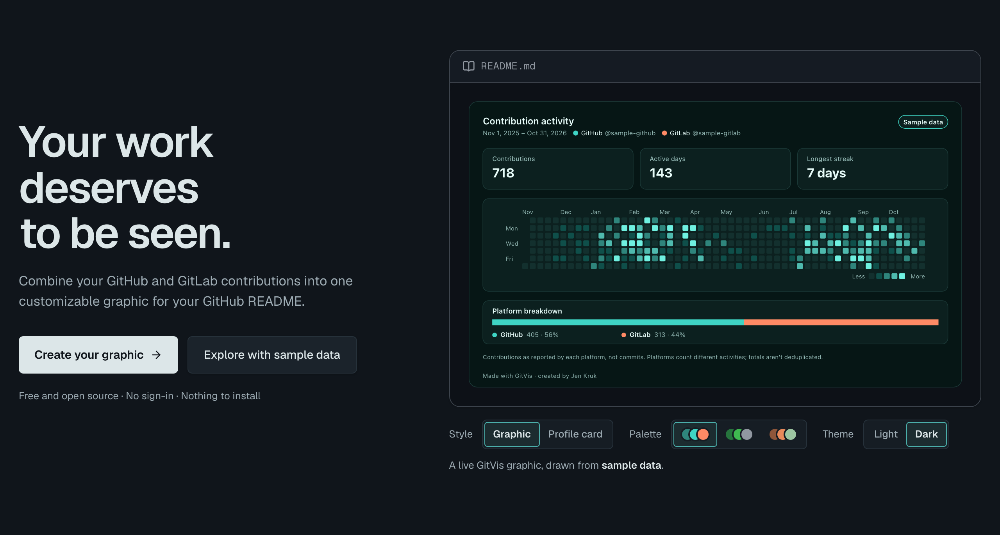

GitVis combines GitHub and GitLab contribution activity into a customizable graphic for your GitHub README.

[Try GitVis](https://gitvis.vercel.app) · [See a live example](https://github.com/jenkruk)

## Getting Started

1. Open **[gitvis.vercel.app](https://gitvis.vercel.app)**.
2. **Connect:** enter your GitHub and/or GitLab username (public data only; no sign-in).
3. **Design:** pick a layout, palette, light or dark mode, profile header, the stats to show and up to three years of history.
4. **Publish:** copy the snippet into your profile README. The image refreshes about every 12 hours on its own.

## How it works

- GitHub data comes from GitHub's GraphQL API; GitLab data from each profile's public contribution calendar.
- The graphic is a self-contained SVG rendered on the server and cached, so READMEs stay fast and nothing runs in the reader's browser.
- Nothing private is read: GitVis only uses public contribution counts, and tokens stay on the server.

## Run it locally

Requires Node 22+.

```bash
npm install
cp .env.example .env.local   # then add a GITHUB_TOKEN (see below)
npm run dev                  # http://localhost:3000
```

`GITHUB_TOKEN` is a fine-grained personal access token with **public repositories read-only** access and no other permissions. GitLab needs no token. The sample-data preview works without one.

| Command             | What it does                                                                     |
| ------------------- | -------------------------------------------------------------------------------- |
| `npm run check`     | Lint, typecheck and unit tests (run before every pull request)                   |
| `npm run test:e2e`  | Browser tests against a production build and a fake upstream (no real API calls) |
| `npm run format`    | Prettier                                                                         |
| `npm run storybook` | Component explorer                                                               |

## Contributing

Contributions are welcome. Start with [CONTRIBUTING.md](CONTRIBUTING.md) for setup and project guidelines. See the technical documentation below for more detail. Please follow the [Code of Conduct](CODE_OF_CONDUCT.md), and report security issues privately using the instructions in [SECURITY.md](SECURITY.md).

## Docs

Technical docs for contributors:

- [Architecture](docs/ARCHITECTURE.md): modules, data flow, platform API findings, security
- [Design system](docs/DESIGN_SYSTEM.md): layouts, palettes, studio foundations, accessibility
- [Deployment](docs/DEPLOYMENT.md): operations and releases

Product reference:

- [Product](docs/PRODUCT.md): vision, users, scope

## How contributions are counted

GitHub and GitLab count different activities (for example, GitLab counts comments and MR approvals). GitVis reports **contributions as each platform defines them**, not raw commits, and combined totals aren't deduplicated.

## License

GitVis is open source under the [MIT License](LICENSE). © 2026 Jennifer Kruk.
